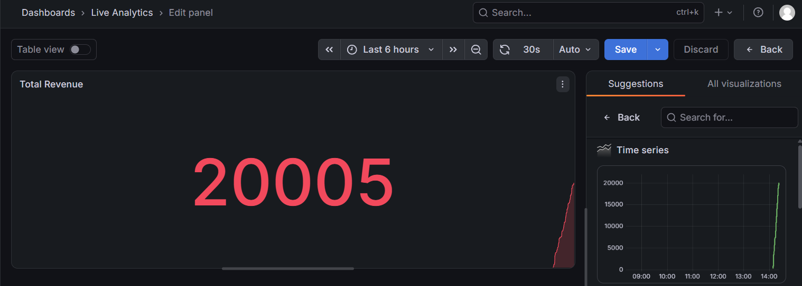

# Real-Time Analytics Pipeline



A production-grade, real-time data streaming and analytics pipeline. This project demonstrates how to ingest high-throughput events, aggregate them, and visualize them live on an enterprise dashboard.

## 🧠 System Design Concepts Demonstrated

1. **Event Streaming (Kafka):** A Python producer generates simulated user events (views, carts, purchases) and streams them to an Apache Kafka topic.
2. **Stream Processing (Consumer):** A background Python consumer listens to the Kafka topic, calculates real-time aggregations (total revenue, total purchases), and writes the metrics to a database.
3. **Time-Series Visualization (Grafana):** Grafana polls the PostgreSQL database and displays the metrics on a live, auto-updating dashboard.

## 🏗️ Architecture

```text
       ┌──────────────┐
       │   Producer   │ (Simulates 1000s of users)
       └──────┬───────┘
              │ JSON Events (views, purchases)
              ▼
       ┌──────────────┐
       │    Kafka     │ (Message Broker)
       └──────┬───────┘
              │ Stream of Events
              ▼
       ┌──────────────┐
       │   Consumer   │ (Aggregates Data)
       └──────┬───────┘
              │ Save Metrics
              ▼
       ┌──────────────┐
       │  PostgreSQL  │ (Metrics DB)
       └──────┬───────┘
              │ Query
              ▼
       ┌──────────────┐
       │   Grafana    │ (Live Dashboard)
       └──────────────┘
```

## 🛠️ Tech Stack

- **Message Broker:** Apache Kafka + Zookeeper
- **Stream Processing:** Python (`kafka-python`)
- **Database:** PostgreSQL
- **Dashboard:** Grafana
- **Orchestration:** Docker Compose

## 🚀 How to Run

**1. Start the infrastructure:**
```bash
docker compose up -d
```

**2. Install dependencies:**
```bash
python -m venv venv
venv\Scripts\activate
pip install -r requirements.txt
```

**3. Start the Consumer (Terminal 1):**
```bash
python -m app.consumer
```

**4. Start the Producer (Terminal 2):**
```bash
python -m app.producer
```

**5. View the Live Dashboard:**
- Go to `http://localhost:3000` (Username: `admin`, Password: `admin`).
- Add a PostgreSQL data source:
  - Host: `db:5432`
  - Database: `metrics_db`
  - User: `metrics_user`
  - Password: `metrics_password`
  - SSL Mode: `disable`
- Create a new panel, switch to **Code**, and run this query:
  ```sql
  SELECT timestamp AS "time", total_amount AS "Total Revenue" FROM metrics ORDER BY timestamp;
  ```
- Watch the revenue update live as purchases happen!

## 📄 License

MIT